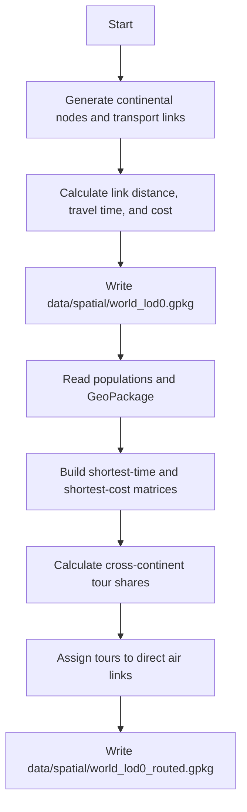

# World LOD0 Model

This project builds a simplified multimodal network and estimates cross-continent passenger-tour flows.

## General flow

The application is coordinated by `app::run()`. The `network` module creates the source network, and the `flows` module reads that network and produces the routed result.

## 1. Network construction

The network contains:

- seven continental centroids;
- one airport for each continent;
- one seaport for each continent;
- two Eurasian land gateways; and
- links between these nodes.

Four transport modes are represented: air, sea, road, and rail. Connectors join the centroid of a continent to its airport and seaport.

## 2. Link distance

For a node pair $(a,b)$, great-circle distance is calculated with the Haversine formula:

$$
\Delta\varphi = \varphi_b-\varphi_a
$$

$$
\Delta\lambda = \lambda_b-\lambda_a
$$

$$
h = \sin^2\left(\frac{\Delta\varphi}{2}\right)
+ \cos(\varphi_a)\cos(\varphi_b)
  \sin^2\left(\frac{\Delta\lambda}{2}\right)
$$

$$
d = 2R\operatorname{arcsin}(\sqrt{h})
$$

where $R=6371.0088$ km. The implementation uses longitude/latitude in radians.

## 3. Link travel time and cost

For each link mode $m$, distance is converted to travel time and operating cost:

$$
t_m = \frac{d}{v_m}
$$

$$
c_m = d \, k_m
$$

where:

| Mode | Speed $v_m$ (km/h) | Cost rate $k_m$ (USD/km) |
|---|---:|---:|
| Air | 850 | 0.18 |
| Sea | 24 | 0.050 |
| Road | 60 | 1.20 |
| Rail | 50 | 0.55 |
| Other/connector | 40 | 0.85 |

Connector links have a minimum distance of 15 km and add a 25 USD cost. Air links add 180 USD and sea links add 60 USD.

## 4. Impedance matrices

The model computes shortest paths independently for two link attributes:

- travel time;
- travel cost.

For a pair of centroid nodes $(o,d)$, Dijkstra's algorithm minimizes:

$$
T(o,d)=\min_{p \in P(o,d)}\sum_{e \in p} t_e
$$

$$
C(o,d)=\min_{p \in P(o,d)}\sum_{e \in p} c_e
$$

These produce separate time and cost matrices used by the destination-choice model.

## 5. Tour generation

The population of origin continent $o$ is $P_o$. The model assumes:

$$
N_o = 2P_o
$$

total tours, with two tours per person. It then sets:

$$
N_o^{cross} = 0.0001 \, N_o
$$

and keeps 99.99% of tours within the origin continent. The same-continent destination itself is not modeled explicitly in the routed output.

## 6. Multinomial logit destination choice

For an origin $o$ and a destination continent $d$, the utility is:

$$
U_{od}
= \ln(P_d)
-0.01T(o,d)
-0.00002C(o,d)
$$

where:

- $P_d$ is destination population;
- $T(o,d)$ is shortest-path travel time in hours;
- $C(o,d)$ is shortest-path cost in USD/tonne.

The probability of choosing destination $d$ is:

$$
\pi_{od}
= \frac{\exp(U_{od})}{\sum_{j \in D_o}\exp(U_{oj})}
$$

To reduce numerical overflow, the implementation subtracts the maximum utility before exponentiating:

$$
\pi_{od}
= \frac{\exp(U_{od}-U_{\max})}
        {\sum_{j \in D_o}\exp(U_{oj}-U_{\max})}
$$

The destination flows are:

$$
F_{od}=N_o^{cross}\pi_{od}
$$

## 7. Network flow assignment

Each $F_{od}$ is assigned to the direct air link between the airport of continent $o$ and the airport of continent $d$:

$$
f_{(o,d)} = \sum_o\sum_d F_{od}
$$

for matching origin/destination airport pairs. Links are undirected in the route calculation, so aggregation combines flows for either direction if the same air link is selected.

The routed output preserves the original network and adds passenger flow information:

- `pax_flow` on aggregated air links;
- an `intercontinental_flows` table with one record per origin-destination pair.

## Key assumptions

- Continents are represented by single centroid nodes.
- A direct airport-to-airport link represents each cross-continent tour.
- Cross-continent choice depends only on destination population, time, and cost.
- The 99.99% same-continent share is fixed rather than estimated.
- The model is simplified and should not be used as a calibrated transport forecast.
